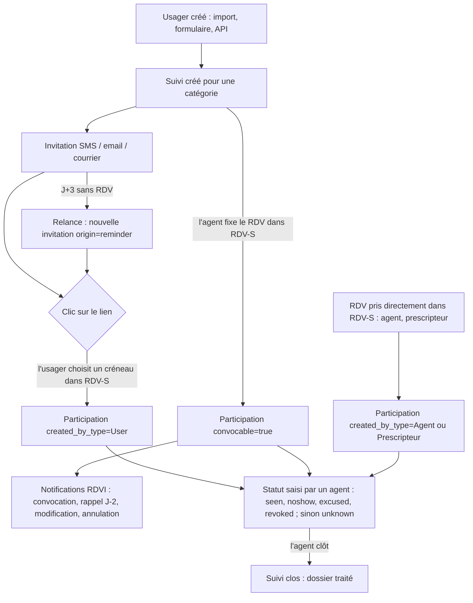
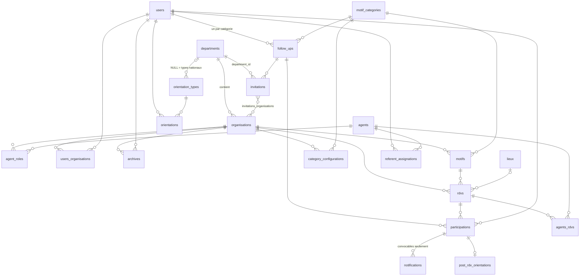

# RDV-Insertion (RDVI) — données

RDV-Insertion aide les départements à suivre les usagers en parcours d'insertion, surtout les
bénéficiaires du RSA. Un agent importe ou crée des usagers, puis il les **invite** à prendre
rendez-vous ou les **convoque**. Le moteur de rendez-vous n'est pas RDVI : c'est
RDV-Service-Public (ex-RDV-Solidarités), qui gère les agendas, les créneaux et les RDV, et
renvoie chaque RDV à RDVI par webhook.

Voir aussi :
- [rdv-insertion.md](../sites/rdv-insertion.md) — Matomo (interface agents) et ses limites ;
- [glossaire bizdev](../bizdev/glossaire.md) — définitions AARRI ; leur traduction SQL est
  donnée [plus bas](#glossaire-bizdev-et-actes-métier) ;
- dictionnaire de colonnes maintenu par l'équipe RDVI, en français :
  [docs/SCHEMA_DATA.md](https://github.com/gip-inclusion/rdv-insertion/blob/main/docs/SCHEMA_DATA.md).
  Ce fichier-ci ne le recopie pas : il documente ce qui est propre à nos copies (ETL,
  anonymisation, fraîcheur), les concepts métier et leur traduction en tables.

Code source : RDVI dans `AGENT.md` (« Dépôts GitHub ») ; moteur de RDV :
`betagouv/rdv-service-public` (branche `production`).

---

## Accès

Deux copies du même schéma `rdvi`, plus le moteur de RDV, accessible seulement par Metabase :

| Accès | Contenu | Quand l'utiliser |
|---|---|---|
| autometa_tables_db, schéma `raw_rdvi` | Copie à l'identique du schéma `rdvi` (mêmes tables, colonnes, types et volumes) | **Par défaut** pour toute question sur RDVI (ordre des sources : `AGENT.md`) |
| Metabase `rdvi`, base 2 « Prod ETL » | Schémas `rdvi`, `rdvs`, `rdvsp`, `csv_uploads` (vide) | Dès qu'il faut le moteur de RDV (`rdvs`) ou une jointure `rdvi` ↔ `rdvs` |

Metabase : https://rdv-service-public-metabase.osc-secnum-fr1.scalingo.io, instance `rdvi`,
variables `METABASE_RDVI_API_KEY` et `METABASE_RDVI_BASIC_AUTH` (`username:password`). Ce
Metabase appartient à l'équipe RDV-Service-Public. La base 5 « Staging ETL » est à ignorer.

```python
from lib.query import CallerType, execute_autometa_tables_query, execute_metabase_query

result = execute_autometa_tables_query(
    sql="SELECT status, COUNT(*) FROM raw_rdvi.participations GROUP BY 1",
    caller=CallerType.AGENT,
)

result = execute_metabase_query(
    instance="rdvi",
    caller=CallerType.AGENT,
    database_id=2,  # Prod ETL, obligatoire
    sql="SELECT COUNT(*) FROM rdvs.rdvs WHERE starts_at >= now() - interval '7 days'",
)
rows = result.data["rows"] if result.success else None
```

Les requêtes ci-dessous visent `raw_rdvi` (autometa_tables_db). Sur Metabase, écrire `rdvi.` à la
place : autometa_tables_db n'a pas de schéma `rdvi`.

---

## À savoir avant toute analyse

### Un instantané, pas un historique

- L'ETL de l'équipe RDV-SP (`betagouv/multi-schema-postgres-etl`) copie la base de production,
  l'anonymise, puis **supprime et recrée** le schéma. Il tourne du dimanche au jeudi, vers 21 h
  UTC pour `rdvi` et 2 h UTC pour `rdvs` (environ 5 h d'écart entre les deux) : le week-end, les
  données datent du jeudi soir. `raw_rdvi` est recopié depuis ce schéma chaque matin (DAG
  Airflow Pilotage `sync_rdvi_raw_schema`).
- L'instantané peut avoir plusieurs jours : pour « à venir » ou « passé », comparer à la date de
  l'instantané (`SELECT MAX(created_at) FROM raw_rdvi.participations`) plutôt qu'à `now()`.
- Aucune table d'historique : `versions` n'est pas exportée. Un statut (`follow_ups.status`,
  `participations.status`) est l'état **au moment de l'instantané**, pas l'état à une date passée.

### La purge RGPD efface le passé

- Chaque nuit, RDVI retire de chaque organisation les usagers inactifs depuis la durée de
  rétention de celle-ci (`organisations.data_retention_duration_in_months`, 24 mois en général,
  de 1 à 36 mois). Un usager qui n'a plus aucune organisation est détruit, avec ses
  participations, invitations et suivis ; les autres restent, mais sortent de
  `users_organisations` pour cette organisation. Les RDV de l'organisation antérieurs à la
  limite et restés sans participation sont détruits aussi.
- Conséquence : **tout comptage sur une période ancienne baisse d'un instantané à l'autre.** En
  octobre 2026, la base ne contenait plus qu'environ la moitié des participations créées en 2023
  et deux tiers de celles de 2024. Les séries antérieures à fin 2024 recalculées en SQL sont
  sous-estimées.
- Les JSON mensuels de `stats` gardent les valeurs d'origine des mois anciens : ils sont la seule
  trace non purgée.
- Côté moteur, RDV-SP détruit les RDV de plus de 2 ans : le schéma `rdvs` ne remonte que sur
  2 ans glissants. RDVI garde ses propres lignes de ces RDV, avec `rdv_solidarites_rdv_id` à NULL.

### Anonymisation

Règle de l'ETL : un texte devient `[valeur unique anonymisée <id>]`, un email
`email_anonymise_<id>@exemple.fr`, une date ou un JSON prend la valeur par défaut de la colonne
(souvent NULL). **Un NULL reste NULL** : on peut mesurer des taux de remplissage (part
d'usagers avec email, téléphone, NIR, numéro CAF, identifiant France Travail).

| Inexploitable dans `rdvi` | Exploitable, à manier avec précaution |
|---|---|
| Noms, adresses, téléphones, emails des usagers ; `users.title` (pas d'analyse par sexe) ; `users.birth_date` (NULL, pas d'analyse par âge) ; `nir`, `affiliation_number`, `france_travail_id` | `agents.email` **en clair** (noms d'agents anonymisés) |
| `archives.archiving_reason` (texte libre) | `users.department_internal_id` : identifiant du dossier dans le SI du département, pseudonyme réidentifiable, à ne jamais diffuser |
| `lieux.name`, `lieux.address` | `users.rights_opening_date` (ouverture des droits RSA) |
| `rdvs.context`, `rdvs.address`, `rdvs.visio_url`, `motifs.instruction_for_rdv`, `invitations.link`, `webhook_endpoints.url`, `user_list_uploads.file_name` | Noms d'organisations et de départements (publics) |

Tables vidées par l'ETL (vides dans Metabase `rdvi`, absentes de `raw_rdvi`) : `versions`,
`address_geocodings` (pas d'analyse géographique infra-départementale), `active_storage_*`. Les énumérations sont des chaînes ; dans `rdvs`, les
enums PostgreSQL (`verticale`, `status`…) sont devenus du `text`.

Dans `rdvs`/`rdvsp`, les emails d'agents sont anonymisés, mais `webhook_endpoints.target_url`,
`lieux.latitude`/`longitude` et `motifs.instruction_for_rdv` restent en clair.

### Dates

Les horodatages sont en UTC (`timestamp` sans fuseau). Les stats officielles découpent les mois
en heure de Paris : `col AT TIME ZONE 'UTC' AT TIME ZONE 'Europe/Paris'` pour s'y caler.
`orientations.starts_at` / `ends_at` sont des `date`.

---

## Trois schémas, deux applications

| Schéma | Application | Contenu |
|---|---|---|
| `rdvi` | RDV-Insertion | Usagers suivis, suivis par catégorie, invitations, convocations, copies des RDV et participations, stats |
| `rdvs` | Moteur RDV-Service-Public, instance **RDV Solidarités** | Organisations des verticales `rdv_solidarites`, `rdv_aide_numerique` et **`rdv_insertion`** |
| `rdvsp` | Même logiciel, instance **RDV Service Public** | Verticales `rdv_mairie`, `rdv_etat` |

- `rdvs` et `rdvsp` ont exactement les mêmes tables et colonnes : ce sont deux bases du même code.
- **Les organisations RDVI vivent dans `rdvs`** (`rdvs.organisations.verticale = 'rdv_insertion'`).
  `rdvsp` ne contient rien de RDVI. Ses identifiants recouvrent ceux de `rdvs` : ne **jamais**
  joindre `rdvi` à `rdvsp`.
- Clés de jointure `rdvi` → `rdvs` : `organisations.rdv_solidarites_organisation_id`,
  `rdvs.rdv_solidarites_rdv_id` (ou `uuid`), `participations.rdv_solidarites_participation_id`,
  `users.rdv_solidarites_user_id`, `motifs.rdv_solidarites_motif_id`,
  `agents.rdv_solidarites_agent_id`.

### Ce que `rdvi` ne voit pas

RDVI n'enregistre un RDV que si son motif a une **catégorie de motif** configurée pour
l'organisation (`category_configurations`). Les autres RDV des mêmes organisations restent dans
`rdvs` seulement.

En 2025, `rdvi` ne contenait que **61 %** des RDV des organisations RDVI. L'écart vient presque
entièrement des motifs sans catégorie : un département qui utilise RDV-Solidarités pour toute
son activité sociale n'en fait remonter qu'une petite partie dans RDVI. Taux de présence dans
`rdvi` en 2025 : 6 % pour les Pyrénées-Atlantiques, 7 % pour le Puy-de-Dôme, 31 % pour
l'Aveyron ; de 79 % à 97 % pour l'Allier, la Creuse, la Seine-Saint-Denis, les Ardennes, la
Drôme, la Haute-Savoie et la Meuse ; 99 % ou plus pour les autres gros départements. Mesurer
avant de conclure (voir [Requêtes types](#requêtes-types)).

| Question | Schéma |
|---|---|
| Activité RDVI : invitations, convocations, suivis, indicateurs officiels, RDV de motifs catégorisés (RSA, SIAE) | `rdvi` / `raw_rdvi` |
| **Tous** les RDV d'une organisation RDVI ou d'un département, quel que soit le motif | `rdvs`, filtré sur `verticale = 'rdv_insertion'` (2 ans d'historique au plus) |
| Un RDV catégorisé donné | Les deux concordent (99,95 % de statuts identiques en octobre 2026) |
| SMS et emails de confirmation et de rappel de **tous** les RDV | `rdvs.receipts` (voir [Notifications](#invitation-convocation-notification)) |

---

## Concepts métier

### Territoire et acteurs

- **Département** (`departments`) : territoire RDVI. Son `id` interne **n'est pas** le code
  INSEE (`number`). L'Allier a deux entrées (dispositifs TZI et RSA) : grouper par `number` pour
  raisonner en territoire. Un département RDVI n'est pas forcément un conseil départemental
  client : une seule organisation, même une SIAE, suffit à le faire exister, et certains
  départements n'ont aucune organisation.
  - `display_in_stats` masque le département des **listes** de la page publique de stats, mais
    ses chiffres restent dans les totaux nationaux.
  - `parcours_enabled` active le module « Parcours » (orientations, diagnostics, contrats).
- **Organisation** (`organisations`) : la structure qui suit les usagers. `organisation_type` ∈
  `conseil_departemental` (services territoriaux du CD), `delegataire_rsa` (associations,
  missions locales… mandatées par le CD), `france_travail`, `siae`, `autre`. Active =
  `archived_at IS NULL`.
- **Agent** (`agents`) : professionnel, rattaché à une ou plusieurs organisations par
  `agent_roles` (`access_level` `basic` ou `admin`). Les comptes `%beta.gouv.fr` et
  `%inclusion.gouv.fr` sont l'équipe produit : à exclure.
- **Référent** (`referent_assignations`) : agent qui suit un usager. Certaines catégories
  exigent un référent pour inviter (`category_configurations.rdv_with_referents`), et un motif
  `follow_up = true` n'est réservable qu'avec son référent.
- **Usager** (`users`) : la personne accompagnée, rattachée à une ou plusieurs organisations
  par `users_organisations`.
  - `role` : `demandeur` ou `conjoint` (souvent NULL).
  - `created_through` : `rdv_insertion_upload_page` (import de fichier),
    `rdv_insertion_user_form`, `rdv_insertion_api` ou `rdv_solidarites_webhook`. Ce dernier
    désigne un usager créé par un RDV reçu de RDV-S, sans être passé par RDVI : typiquement un
    usager convoqué directement dans RDV-S. Ils restent hors du taux d'orientés tant qu'ils
    ne sont pas invités, ce taux ne comptant que les suivis invités. NULL pour les comptes anciens.
  - `deleted_at` : suppression logique. Les taux officiels (no-show, autonomie, orientation)
    ne portent que sur les usagers actifs ; le délai moyen invitation → RDV et les volumes
    (rendez-vous pris, invitations, usagers gérés au national) incluent les supprimés.

### Catégories, motifs, configuration

- **Catégorie de motif** (`motif_categories`) : le type de démarche (« RSA orientation »,
  « RSA accompagnement », « RSA signature CER », « Entretien SIAE »…). `motif_category_type` ∈
  `rsa_orientation`, `rsa_accompagnement`, `siae`, `autre`. Toute l'activité RDVI s'organise par
  catégorie.
- **Motif** (`motifs`) : la prestation précise d'une organisation, rattachée à une catégorie.
  Porte `location_type` (`public_office` = sur place, `phone`, `home` = à domicile, `visio`),
  `collectif`, `bookable_by` (qui peut réserver : `agents`, `agents_and_prescripteurs`,
  `agents_and_prescripteurs_and_invited_users`, `everyone`). **Le lieu et le caractère
  collectif se lisent sur le motif, pas sur le RDV.**
- **Configuration de catégorie** (`category_configurations`) : réglages d'une organisation
  pour une catégorie : formats d'invitation, `number_of_days_before_invitations_expire` (10 par
  défaut ; NULL = invitations sans expiration), `convene_user` (convocation possible),
  `rdv_with_referents`.

### Suivi (« dossier »)

Un **suivi** (`follow_ups`) est le couple usager × catégorie de motif : « le dossier RSA
orientation de M. X ». C'est l'unité du parcours. Son statut résume où en est l'usager pour
cette catégorie (voir [Statut d'un suivi](#statut-dun-suivi)). « Dossier traité » = suivi clos
par un agent.

### Invitation, convocation, notification

- **Invitation** (`invitations`) : message demandant à l'usager de **choisir lui-même** un
  créneau, via un lien vers RDV-S. Aucun RDV n'existe encore. Rattachée au suivi
  (`follow_up_id`), au département (`department_id`) et à une ou plusieurs organisations
  (`invitations_organisations`).
  - `format` : `sms`, `email` ou `postal`. Un courrier est un **PDF généré** que l'agent
    imprime : rien ne prouve son envoi.
  - `origin` remplace l'ancienne colonne `trigger` (supprimée en juillet 2026) :
    - à l'initiative d'un agent : `user_list_upload` (import), `users_index_page`,
      `user_follow_ups_page`, `api` ; ces trois dernières n'existent que depuis le 9 juillet 2026 ;
    - relance automatique : `reminder` ;
    - historiques : `legacy_triggered_by_agent` (ex-`manual`), `legacy_triggered_by_periodic_job`
      (ex-`periodic`, fonctionnalité supprimée) ;
    - `user_list_upload` n'a été attribué rétroactivement qu'aux invitations des imports
      journalisés depuis janvier 2025 : avant, imports et envois manuels sont confondus dans
      `legacy_triggered_by_agent`.
  - `created_by_agent_id` : l'agent qui invite, renseigné depuis le 9 juillet 2026.
  - `expires_at` : fin de validité. Elle est aussi **forcée à la date du jour** quand un RDV est
    pris sur le suivi, quand le suivi est clos ou quand l'usager est archivé dans toutes les
    organisations de l'invitation. Une invitation
    expirée n'est donc pas forcément restée sans réponse.
  - `clicked` : l'usager a ouvert le lien. Un clic sur une invitation déjà expirée n'est pas
    enregistré.
  - `delivery_status` : retour du prestataire d'envoi (Brevo) : `delivered`, `soft_bounce`,
    `hard_bounce`, `blocked`, `invalid_email`, `error`. **NULL = pas de retour** : toujours pour
    le courrier, et pour les SMS envoyés par un autre prestataire que Brevo. Il n'existe pas de valeur `unknown`.
- **Relance** : automatique, trois jours après la dernière invitation d'agent si celle-ci était
  un SMS ou un email, tant que le suivi est `invitation_pending` et que l'invitation reste valide
  au moins deux jours. Jamais après un courrier ni pour une invitation sans expiration. La relance
  part sur **chaque canal disponible** (SMS si mobile, email si email), même si l'invitation
  n'en utilisait qu'un : en général deux nouvelles lignes `invitations` (`origin = 'reminder'`)
  le même jour, chacune avec son propre `clicked`. Dédupliquer par suivi pour compter des
  usagers relancés.
- **Convocation** : l'agent **fixe lui-même** le RDV dans RDV-S (bouton « Convoquer »), puis
  RDVI prévient l'usager. La participation reçue porte `convocable = true`, valeur figée à la
  création : le nom du motif contient « convocation », ou un agent a inscrit l'usager à un RDV
  collectif (la **participation** est créée par un agent ; un usager qui s'inscrit seul à un
  collectif n'est pas convoqué), **et** la catégorie autorise la convocation (`convene_user`).
- **Notification** (`notifications`) : message de RDVI sur un RDV **déjà fixé**. RDVI n'en
  envoie **que pour les participations `convocable`** : ce sont les convocations et leur cycle.
  `event` ∈ `participation_created` (la convocation elle-même), `participation_updated` (date ou
  lieu changés), `participation_cancelled` (envoyée quand le **service** annule un RDV à venir,
  pas quand l'usager s'excuse), `participation_reminder` (rappel deux jours avant). Une ligne par
  canal : `COUNT(DISTINCT participation_id)` pour compter des convocations. Le format `postal`
  est un PDF.
- **Messages envoyés par RDV-S** : pour les RDV non convoqués, la confirmation et le rappel
  partent de RDV-S, et se lisent dans `rdvs.receipts` (`event` ∈ `rdv_created`, `rdv_updated`,
  `rdv_upcoming_reminder`, `rdv_cancelled`, `participation_cancelled`…). Pour une convocation,
  RDV-S envoie souvent **aussi** son propre message (environ 6 convocations sur 10 en
  septembre 2026) : ne pas additionner les deux sources.

### RDV et participation

- **RDV** (`rdvs`) : un rendez-vous fixé dans RDV-S. Ce n'est **pas** un créneau.
- **Participation** (`participations`) : la présence d'**un** usager à un RDV, avec son
  statut. Un RDV collectif a plusieurs participations ; un RDV individuel peut en avoir
  plusieurs (conjoint). En octobre 2026 : environ 1,2 participation par RDV en moyenne ; les collectifs sont 4 %
  des RDV mais 20 % des participations.
- **C'est la participation que RDVI appelle « rendez-vous »** : stats officielles, exports,
  statuts de suivi.

Statuts de participation :

| `status` | Libellé RDVI | Sens |
|---|---|---|
| `unknown` | « RDV à venir » si le RDV est futur, « Statut du RDV à préciser » s'il est passé | Aucun statut saisi. Rien ne bascule automatiquement un RDV passé |
| `seen` | Rendez-vous honoré | L'usager est venu |
| `noshow` | Absence non excusée | L'usager n'est pas venu sans prévenir |
| `excused` | Annulé (excusé) | L'usager a annulé ou prévenu |
| `revoked` | Annulé (par le service) | La structure a annulé |

- Le statut est saisi par un agent, dans RDV-S ou dans RDVI. L'usager ne peut poser que
  `excused` (annulation en ligne).
- `rdvs.status` est un statut agrégé calculé par RDV-S à partir des participations. Un collectif
  n'y vaut que `unknown`, `seen` ou `revoked`. **Compter sur `participations.status`.**
- `rdvs.users_count` = participations non annulées au sens de RDV-S (`unknown`, `seen`,
  `noshow`) ; `max_participants_count` = capacité d'un collectif.
- **Qui a pris le RDV** : `participations.created_by_type` ∈ `User` (l'usager lui-même, en
  autonomie), `Agent`, `Prescripteur` (prescripteur externe). Un agent qui réserve pour une autre
  structure a `created_by_type = 'Agent'` et `created_by_agent_prescripteur = true`.
  `rdvs.created_by` (`agent`, `user`, `prescripteur` ; quelques lignes `file_attente` ou NULL) est l'auteur
  du RDV entier : un collectif est créé par un agent même si les usagers s'y inscrivent seuls.
- Agents d'un RDV : `agents_rdvs` = les agents qui **tiennent** le RDV (couverture 88 % des RDV
  en 2025, 98,6 % en 2026). `participations.rdv_solidarites_created_by_id` = l'agent qui l'a
  **créé** (si `created_by_type = 'Agent'`, joindre à `agents.rdv_solidarites_agent_id`) ;
  renseigné pour la moitié des participations de 2025 et toutes celles de 2026.

### Orientation : trois notions distinctes

1. **Suivi d'orientation** : suivi de catégorie `rsa_orientation`. « Usager orienté » dans les
   stats officielles = usager ayant honoré un RDV sur ce suivi.
2. **Orientation administrative** (`orientations` + `orientation_types`) : décision du
   département sur le type d'accompagnement, avec une période (`ends_at IS NULL` = en cours) et
   une structure référente. `orientation_types.casf_category` ∈ `pro`, `socio_pro`, `social` ;
   les noms (« Emploi », « Remobilisation »…) varient selon le département
   (`department_id IS NULL` = types nationaux par défaut). Saisie dans le module Parcours, donc
   dans quelques départements seulement (en 2026 surtout Drôme, Territoire de Belfort, Allier-RSA,
   Yvelines).
3. **Orientation décidée en RDV** (`post_rdv_orientations`) : orientation enregistrée à l'issue
   d'un RDV d'orientation honoré, une par participation.

Le module Parcours stocke aussi les diagnostics et contrats d'engagement (CER) dans
`parcours_documents` (`type` ∈ `Diagnostic`, `Contract`).

### Archivage, import, créneaux

- **Archivage** (`archives`) : retrait d'un usager de la liste active d'**une organisation**
  (`organisation_id` ; il n'y a plus de `department_id`). L'archive est supprimée quand un agent
  désarchive l'usager, quand un import le réintègre ou quand il quitte l'organisation : la table
  décrit l'état courant, pas l'historique des archivages. Le motif est anonymisé.
- **Import** (`user_list_uploads`) : un fichier chargé (`origin = 'file_upload'`) ou un envoi en
  masse aux non-invités (`origin = 'invite_all_uninvited_button'`). Résultat par ligne dans
  `user_list_upload_user_save_attempts` et `user_list_upload_invitation_attempts` (`success`) ;
  fin de traitement dans `user_list_upload_processing_logs`.
- **Créneau** : une disponibilité calculée à la volée par RDV-S (plages d'ouverture
  `rdvs.plage_ouvertures` − absences `rdvs.absences` − RDV existants, Metabase seulement). **Aucune table ne stocke les créneaux**, et RDVI n'envoie jamais de
  créneaux : il envoie un lien (invitation) ou un RDV déjà fixé (convocation). Traces de la
  disponibilité :
  - `category_configuration_creneau_availabilities` : relevé quotidien, par organisation et
    catégorie, des créneaux disponibles face aux invitations en attente. RDV-S arrête de compter
    vers 200 : une valeur de 200 ou plus signifie « au moins 200 » ;
  - `blocked_invitations_counters` (relevé quotidien), `blocked_users` : invitations valides dont
    le lien ne menait à aucun créneau (contrôle nocturne) ;
  - `creneau_opening_requests` : demandes d'ouverture de créneaux envoyées à des agents depuis
    un import ;
  - côté RDV-S, hors RDVI : `rdvs.rdv_invitations` (un agent RDV-S envoie un lien de réservation
    à un usager), `rdvs.file_attentes` et `rdvs.receipts.event = 'new_creneau_available'` (liste
    d'attente).

---

## Les chemins vers un RDV



Le RDV et ses participations arrivent ensemble dans RDVI, par le même webhook. Une participation
a toujours un suivi : le webhook le crée s'il n'existe pas, et crée l'usager s'il est inconnu.

---

## Statut d'un suivi

`follow_ups.status` est **stocké et recalculé** à chaque événement (invitation, participation,
RDV), par un job planifié à l'échéance de la dernière invitation ou du dernier RDV, et par un
cron quotidien. Ce n'est pas un automate : c'est une fonction de l'état courant, évaluée dans cet
ordre.

1. `closed_at` renseigné → **`closed`** (« Dossier traité »). Clôture manuelle par un agent,
   depuis n'importe quel statut. Réouverture par l'agent, ou automatique quand l'API ou un import
   ré-invite l'usager. Un RDV peut arriver sur un suivi clos sans le rouvrir. Jamais automatique
   après un RDV honoré.
2. Ni invitation ni participation → **`not_invited`**. Ces suivis sont supprimés si l'usager
   quitte l'organisation : ils sont sous-comptés.
3. Dernière invitation **postérieure** à la dernière participation créée → **`invitation_pending`**
   (une invitation encore valide) ou **`invitation_expired`** (toutes expirées). Si cette
   participation est à venir, la comparaison se fait avec la **date du RDV** : une invitation
   envoyée entre la prise du RDV et le RDV laisse le suivi en `rdv_pending`.
4. Sinon, d'après les participations :
   - une participation future en `unknown` → **`rdv_pending`** ;
   - dernière participation `seen`, ou participation `seen` dont le RDV est postérieur à la
     création de la dernière participation → **`rdv_seen`** ;
   - dernière participation `noshow`, `excused` ou `revoked` → **`rdv_noshow`**,
     **`rdv_excused`**, **`rdv_revoked`** ;
   - dernière participation passée et `unknown` → **`rdv_needs_status_update`** (« Statut du RDV
     à préciser »).

« Dernière participation » s'entend au sens de la **dernière créée**, pas du dernier RDV par
date. Une invitation sans expiration n'expire jamais : le suivi reste `invitation_pending`. Une
nouvelle invitation ou un nouveau RDV peut partir de tout statut non clos. Pièges :

- le statut ne reflète que la dernière participation créée : ne pas l'utiliser pour compter des
  RDV honorés ou un premier RDV honoré ;
- un comptage de suivis « par statut » sur une période passée donne leur statut **d'aujourd'hui**,
  pas celui de l'époque, et n'est pas reproductible.

---

## Traduction : concept métier → tables

Pour les concepts de RDV, partir de `participations` jointe à `rdvs`. La catégorie se lit par
`participations.follow_up_id → follow_ups.motif_category_id → motif_categories`.

| On parle de… | Table et filtre | Pièges |
|---|---|---|
| **Usager géré, suivi** | `users` actifs (`deleted_at IS NULL`) rattachés à une organisation (`users_organisations`) | Un usager peut appartenir à plusieurs organisations d'un même département : `COUNT(DISTINCT)` |
| **Invitation envoyée** | `invitations`, daté par `created_at` | Comprend les relances (`origin = 'reminder'`) et les échecs d'envoi. Le courrier est un PDF généré |
| **Invitation envoyée par un agent** | `origin NOT IN ('reminder', 'legacy_triggered_by_periodic_job')` | |
| **Relance** | `origin = 'reminder'` | Une ligne par canal, à J+3, jamais pour le courrier : dédupliquer par `follow_up_id` et jour pour compter des relances |
| **Invitation délivrée** | `delivery_status = 'delivered'` | NULL = pas de retour, pas un échec. Échec : `soft_bounce`, `hard_bounce`, `blocked`, `invalid_email`, `error` |
| **Invitation cliquée** | `clicked` | Relance et originale ont chacune leur clic : dédupliquer par `follow_up_id` |
| **Invitation restée sans réponse** | Suivi `invitation_expired` aujourd'hui ; ou, à une date, invitation expirée sans participation créée après elle sur le même suivi | `expires_at` est aussi forcé quand un RDV est pris |
| **Envoi de créneau** | N'existe pas. Selon le sens visé : invitation (lien vers les créneaux), convocation (RDV fixé), `rdvs.rdv_invitations` (lien de réservation d'un agent RDV-S), tables de disponibilité ([Créneaux](#archivage-import-créneaux)) | Demander ce que l'utilisateur entend |
| **Rendez-vous pris** (au sens officiel) | `participations`, datée par `created_at` (date de **prise**) | Tous statuts, annulés compris. ≠ `COUNT(rdvs)` |
| **RDV pris en autonomie** | `participations.created_by_type = 'User'` | Pas `rdvs.created_by` |
| **RDV pris par l'agent** | `created_by_type = 'Agent' AND NOT created_by_agent_prescripteur` | |
| **RDV prescrit** | `created_by_type = 'Prescripteur'` (externe) ou `created_by_agent_prescripteur` (agent d'une autre structure) | |
| **RDV pris suite à une invitation** | Participation non convoquée dont le suivi a une invitation antérieure : `NOT p.convocable AND EXISTS (invitations i WHERE i.follow_up_id = p.follow_up_id AND i.created_at <= p.created_at)` | Sans `NOT p.convocable`, un quart des lignes sont des convocations faites après une invitation restée sans suite. L'invitation peut être ancienne : borner si besoin. La stat officielle « après invitation » ne vérifie pas l'ordre (voir [Indicateurs](#indicateurs-officiels)) |
| **Usager convoqué** | `participations.convocable` | |
| **Convocation envoyée** | `notifications.event = 'participation_created'` ; `COUNT(DISTINCT participation_id)` | Une ligne par canal. 6 % des convocables n'ont aucune notification (RDV créé dans le passé, usager sans contact ; octobre 2026) |
| **RDV à venir** | `p.status = 'unknown' AND r.starts_at > (SELECT MAX(created_at) FROM raw_rdvi.participations)` | Comparer à la date de l'instantané, pas à `now()` |
| **RDV honoré** | `p.status = 'seen'`, daté par `r.starts_at` | |
| **Absence non excusée (lapin)** | `p.status = 'noshow'` | |
| **RDV annulé par l'usager** | `p.status = 'excused'` | Peut aussi être saisi par l'agent (« l'usager a prévenu ») |
| **RDV annulé par le service** | `p.status = 'revoked'` | Ce n'est ni un refus ni une absence de l'usager |
| **RDV dont on ne sait pas s'il a été honoré** | `p.status = 'unknown' AND r.starts_at <= (SELECT MAX(created_at) FROM raw_rdvi.participations)` | Les agents saisissent avec retard : près d'un tiers des RDV de la dernière semaine sont encore `unknown`. Pour un taux, écarter les 7 derniers jours avant l'instantané (`r.starts_at < (SELECT MAX(created_at) FROM raw_rdvi.participations) - interval '7 days'`). En hausse : 2,5 % des RDV passés de 2023, 7 % en 2025-2026 ; près de 20 % pour la Creuse et le Vaucluse, 15 % pour l'Allier-RSA (départements de plus de 5 000 participations). Côté suivi : `rdv_needs_status_update` (dernier RDV seulement) |
| **RDV collectif** | `rdvs` ⋈ `motifs` : `motifs.collectif` | Compter les présences sur les participations |
| **RDV sur place, téléphone, domicile, visio** | `motifs.location_type` | Pas sur `rdvs` |
| **Usager invité** | `EXISTS (invitations i WHERE i.user_id = u.id)`, usagers actifs ; par catégorie via `follow_up_id` | Dénominateur des taux officiels d'autonomie et d'orientation |
| **Usager orienté** | Participation `seen` sur un suivi `rsa_orientation` | Plusieurs sens : voir [Orientation](#orientation--trois-notions-distinctes) |
| **Usager accompagné** | Participation `seen` sur un suivi `rsa_accompagnement` | |
| **Taux de conversion invitation → RDV d'orientation honoré** | Indicateur officiel : `stats.rate_of_users_oriented` (cumulé) ou `rate_of_users_oriented_grouped_by_month` (par mois de création du suivi), sur la ligne dédoublonnée du périmètre | Orientation seulement. Pour une autre catégorie, recalculer en SQL avec la même définition (voir [Formules](#formules)) et nommer l'écart avec l'officiel |
| **Délai de prise de RDV** | Par suivi : `MIN(p.created_at) − MIN(i.created_at)`, seulement si `MIN(p.created_at) >= MIN(i.created_at)` (indicateur officiel) | Ne compte que les suivis convertis. Sans la condition, une convocation antérieure à l'invitation donne un délai négatif |
| **Délai jusqu'au RDV** | Par suivi : `MIN(r.starts_at) − MIN(i.created_at)`, sur les participations créées après la 1re invitation | Mesure différente de l'officielle : la nommer, et dire si les RDV annulés (`excused`, `revoked`) comptent |
| **Agent actif** | Agent qui tient un RDV : `agents_rdvs` (complet depuis 2026 ; 12 % des RDV de 2025 sans agent) ; agent qui invite : `invitations.created_by_agent_id` (depuis le 9 juillet 2026) ; agent qui crée le RDV : `participations.rdv_solidarites_created_by_id` avec `created_by_type = 'Agent'` (complet depuis 2026) | Choisir et nommer le sens. Exclure l'équipe produit. `agents.last_sign_in_at` ne garde que la dernière connexion |
| **Orientation en cours** | `orientations` où `starts_at <= current_date AND (ends_at IS NULL OR ends_at >= current_date)` | Module Parcours, quelques départements |
| **Dossier traité** | `follow_ups.closed_at IS NOT NULL` | Clôture manuelle |
| **Usager archivé** | `archives` pour l'organisation concernée | Par organisation ; « archivé partout » = archivé dans toutes ses organisations |
| **Invitations bloquées faute de créneaux** | `blocked_invitations_counters`, `blocked_users` | Recomptées chaque nuit tant que le blocage dure |
| **Tous les RDV d'un CD** (tous motifs) | `rdvs.rdvs` ⋈ `rdvs.organisations` (`verticale = 'rdv_insertion'`) ⋈ `rdvs.territories` (`departement_number`) | Metabase seulement, 2 ans d'historique |
| **SMS / email de RDV envoyé à l'usager** | `rdvi.notifications` (convocations) et `rdvs.receipts` (tous les RDV) | Doublons sur les convocations ; un mail `processed` est remis au prestataire, pas délivré |

---

## Indicateurs officiels

### La table `stats`

Une ligne par périmètre : `statable_type = 'Department'` avec `statable_id IS NULL` pour la
**ligne nationale**, une ligne par département, une par organisation. RDVI la recalcule chaque
semaine (fin de semaine).

- Les colonnes scalaires (`rate_of_*`, `average_time_between_invitation_and_rdv_in_days`,
  `agents_count`) sont **cumulées depuis l'origine**, sur les données encore présentes.
- Les colonnes `*_grouped_by_month` sont des `json` aux clés `"MM/YYYY"`. Seuls les mois de
  l'année écoulée sont recalculés ; les plus anciens gardent leur dernière valeur calculée, et
  ne subissent donc plus la purge.
- Les totaux affichés (« rendez-vous pris », « usagers ») sont la somme de ces JSON : il n'y a
  pas de colonne `rdvs_count` ou `users_count`.
- **Doublons** : quelques départements et organisations ont plusieurs lignes, dont une seule est
  à jour. Toujours dédoublonner (voir [Requêtes types](#requêtes-types)).

### Formules

| Indicateur (page /stats) | Colonne | Calcul | Mois de rattachement (série mensuelle) |
|---|---|---|---|
| Rendez-vous pris | Σ `rdvs_count_grouped_by_month` | Participations, tous statuts, sans filtre | Création de la participation (prise du RDV) |
| Usagers gérés | Σ `users_count_grouped_by_month` | Usagers. Au national, supprimés compris ; par département, compte en double les usagers de plusieurs organisations | Création du compte usager |
| Invitations envoyées | Σ `sent_invitations_count_grouped_by_month` | Toutes les invitations, relances et courriers compris | Création de l'invitation |
| Rendez-vous non honorés | `rate_of_no_show` | `noshow / (seen + excused + revoked + noshow)` : `unknown` exclu, annulations **incluses** au dénominateur | Création de la participation |
| … après convocation | `rate_of_no_show_for_convocations` | Même formule sur les participations ayant au moins une notification | idem |
| … après invitation | `rate_of_no_show_for_invitations` | Participations sans notification dont le suivi a une invitation, à n'importe quelle date | idem |
| Délai moyen invitation → RDV | `average_time_between_invitation_and_rdv_in_days` | Par suivi : 1re participation **créée** − 1re invitation, en jours entiers ; seulement les suivis dont la 1re participation suit la 1re invitation. Mesure le délai de **prise** du RDV, pas la date du RDV | 1re invitation |
| Usagers en autonomie | `rate_of_autonomous_users` | Usagers invités ayant au moins une participation `created_by_type = 'User'` / usagers invités | Création du compte usager |
| Orientation réalisée via RDVI | `rate_of_users_oriented` | Usagers ayant un RDV `seen` sur un suivi `rsa_orientation` invité / usagers ayant un tel suivi invité | Création du suivi |
| Orientés en moins de 45 jours | `rate_of_users_oriented_in_less_than_45_days` | Premier suivi `rsa_orientation` créé il y a plus de 45 jours, **invité ou non** ; 1er RDV `seen` moins de 45 jours après sa création | Création du suivi |
| Accompagnés en moins de 30 jours | `rate_of_users_accompanied_in_less_than_30_days` | Même logique pour `rsa_accompagnement`, depuis le RDV d'orientation honoré s'il existe | Création du suivi |
| Usagers rencontrés | Σ `users_with_rdv_count_grouped_by_month` | Usagers distincts, actifs et encore rattachés au périmètre, ayant une participation `seen` ou `unknown` (RDV à venir et non renseignés compris) ; la somme des mois n'est pas un nombre d'usagers uniques | Création de la participation, pas date du RDV |
| Agents | `agents_count` | Agents rattachés au périmètre **qui se sont connectés au moins une fois**, hors équipe. Pas des agents actifs | — |

Les taux portent sur les usagers actifs du périmètre, sauf le délai moyen, qui compte aussi les
supprimés. Les volumes incluent les supprimés, sauf « usagers rencontrés ».
Les seuils de 45 et 30 jours approchent les délais du décret 2024-1244 (orientation sous six
semaines, contrat d'engagement sous quatre semaines). Pour le second, RDVI mesure un RDV
d'accompagnement honoré, pas une signature de contrat.

**Reproduire un chiffre de la page** : sommer le JSON de la ligne concernée, dédoublonnée. Un
`COUNT(*)` sur `participations` donne moins, à cause de la purge (1 011 842 rendez-vous pris
affichés contre 896 598 participations en base en octobre 2026).

**Taux de no-show « métier »** : pour un absentéisme parmi les RDV tenus, préférer
`noshow / (seen + noshow)` sur les RDV passés, par mois de `starts_at`, et le nommer autrement
que le taux officiel (environ 16 % contre 13 % en 2026).

---

## Glossaire bizdev et actes métier

Traduction des définitions RDV-Insertion du [glossaire](../bizdev/glossaire.md) :

| Étape | Définition | Traduction |
|---|---|---|
| Acquisition | Contrat de sous-traitance des données signé | Approximation : `dpa_agreements`, acceptation dans l'outil, une par **organisation** (pas par CD), seulement depuis janvier 2025 ; les organisations plus anciennes ont la date de leur premier passage. Avant 2025 : `organisations.created_at` ou premier mois non nul du JSON `stats` |
| Activation | 1er RDV honoré | `MIN(r.starts_at)` des participations `seen`, par organisation, département (`number`) ou agent (`agents_rdvs`). Pas `follow_ups.status`. La purge peut avoir effacé les premiers RDV : comparer avec le premier mois non nul du JSON `stats` |
| Rétention agent | Agent ≥ 1 RDV par mois | Agent qui **tient** un RDV : `agents_rdvs`, par mois de `starts_at`, hors équipe produit. Complet depuis 2026 (12 % des RDV de 2025 sans agent). Autres sens possibles, à nommer : agent qui crée le RDV, agent qui invite |
| Rétention CD | CD ≥ 1 participation par mois | Grouper par `departments.number`. Deux arbitrages : quels types d'organisation comptent comme « le CD » (délégataires RSA compris ?), et participation créée ou honorée ? |
| Maturité | `rate_of_autonomous_users` | Voir [Formules](#formules) |
| Pénétration | Actifs / 101 CD | `rdvi.departments` comptait 82 lignes pour 81 codes INSEE en octobre 2026, dont 7 sans aucune organisation et plusieurs quasi inactifs : compter les départements actifs, pas les lignes |

**Acte métier RDVI : deux définitions coexistent.**

- `knowledge/stats/actes-metier.md` décrit des **participations**, avec un mapping de statut.
- Le modèle dbt Pilotage `int_rdvi__actes_metiers`, qui alimente `public.actes_metier`
  (`source = 'rdvi'`) dans autometa_tables_db, compte des **invitations**, avec des booléens
  `north_star` et `traite`, sans statut.

---

## Requêtes types

**Participations du mois dernier avec leur contexte** (département, catégorie, statut, mode de
prise) :

```sql
SELECT d.number AS departement, mc.motif_category_type, p.status,
       p.created_by_type, p.convocable, COUNT(*)
FROM raw_rdvi.participations p
JOIN raw_rdvi.rdvs r ON r.id = p.rdv_id
JOIN raw_rdvi.organisations o ON o.id = r.organisation_id
JOIN raw_rdvi.departments d ON d.id = o.department_id
JOIN raw_rdvi.follow_ups f ON f.id = p.follow_up_id
JOIN raw_rdvi.motif_categories mc ON mc.id = f.motif_category_id
WHERE r.starts_at >= date_trunc('month', now()) - interval '1 month'
  AND r.starts_at < date_trunc('month', now())
GROUP BY 1, 2, 3, 4, 5;
```

**RDV passés non renseignés, par département** (12 derniers mois) :

```sql
SELECT d.number, d.name,
       COUNT(*) FILTER (WHERE p.status = 'unknown') AS non_renseignes,
       COUNT(*) AS rdv_passes,
       ROUND(100.0 * COUNT(*) FILTER (WHERE p.status = 'unknown') / COUNT(*), 1) AS pct
FROM raw_rdvi.participations p
JOIN raw_rdvi.rdvs r ON r.id = p.rdv_id
JOIN raw_rdvi.organisations o ON o.id = r.organisation_id
JOIN raw_rdvi.departments d ON d.id = o.department_id
WHERE r.starts_at < (SELECT MAX(created_at) FROM raw_rdvi.participations) - interval '7 days'
  AND r.starts_at >= now() - interval '12 months'
GROUP BY 1, 2
HAVING COUNT(*) >= 1000
ORDER BY pct DESC;
```

**Conversion à 30 jours des suivis invités, par mois de leur première invitation d'agent**
(relances exclues ; RDV pris par l'usager ou un tiers, convocations exclues ; cohortes de moins
de 30 jours écartées) :

```sql
WITH inv AS (
  SELECT i.follow_up_id, MIN(i.created_at) AS premiere_invitation
  FROM raw_rdvi.invitations i
  WHERE i.origin NOT IN ('reminder', 'legacy_triggered_by_periodic_job')
  GROUP BY 1
)
SELECT date_trunc('month', inv.premiere_invitation)::date AS mois,
       COUNT(*) AS suivis_invites,
       COUNT(*) FILTER (WHERE EXISTS (
         SELECT 1 FROM raw_rdvi.invitations c
         WHERE c.follow_up_id = inv.follow_up_id AND c.clicked
           AND c.created_at >= inv.premiere_invitation
           AND c.created_at < inv.premiere_invitation + interval '30 days')) AS avec_clic_30j,
       COUNT(*) FILTER (WHERE EXISTS (
         SELECT 1 FROM raw_rdvi.participations p
         WHERE p.follow_up_id = inv.follow_up_id AND NOT p.convocable
           AND p.created_at >= inv.premiere_invitation
           AND p.created_at < inv.premiere_invitation + interval '30 days')) AS avec_rdv_30j
FROM inv
WHERE inv.premiere_invitation >= date_trunc('year', now())
  AND inv.premiere_invitation < (SELECT MAX(created_at) FROM raw_rdvi.participations) - interval '30 days'
GROUP BY 1 ORDER BY 1;
```

`clicked` n'est pas daté : `avec_clic_30j` compte un clic sur une invitation envoyée dans les
30 jours, quelle que soit la date du clic.

**No-show (formule officielle) et absentéisme parmi les RDV tenus, par mois de RDV** (la série
officielle, elle, est datée par création de la participation et limitée aux usagers actifs) :

```sql
SELECT date_trunc('month', r.starts_at)::date AS mois,
       ROUND(100.0 * COUNT(*) FILTER (WHERE p.status = 'noshow')
         / NULLIF(COUNT(*) FILTER (WHERE p.status IN ('seen', 'excused', 'revoked', 'noshow')), 0), 1) AS no_show_formule_officielle,
       ROUND(100.0 * COUNT(*) FILTER (WHERE p.status = 'noshow')
         / NULLIF(COUNT(*) FILTER (WHERE p.status IN ('seen', 'noshow')), 0), 1) AS absenteisme_rdv_tenus
FROM raw_rdvi.participations p
JOIN raw_rdvi.rdvs r ON r.id = p.rdv_id
WHERE r.starts_at >= date_trunc('year', now()) AND r.starts_at < date_trunc('month', now())
  AND r.starts_at < (SELECT MAX(created_at) FROM raw_rdvi.participations) - interval '7 days'
GROUP BY 1 ORDER BY 1;
```

**Indicateurs officiels par département, dédoublonnés** :

```sql
SELECT * FROM (
  SELECT DISTINCT ON (s.statable_id)
         d.number, d.name, s.agents_count, s.rate_of_no_show, s.rate_of_autonomous_users,
         s.rate_of_users_oriented, s.average_time_between_invitation_and_rdv_in_days, s.updated_at
  FROM raw_rdvi.stats s
  JOIN raw_rdvi.departments d ON d.id = s.statable_id
  WHERE s.statable_type = 'Department'
  ORDER BY s.statable_id, s.updated_at DESC
) t ORDER BY agents_count DESC;
```

**« Rendez-vous pris » comme sur la page publique** (ligne nationale ; pour un département,
`statable_id = <departments.id>`, pas le code INSEE) :

```sql
SELECT SUM(v::int) AS rendez_vous_pris
FROM (SELECT DISTINCT ON (statable_id) *
      FROM raw_rdvi.stats
      WHERE statable_type = 'Department' AND statable_id IS NULL
      ORDER BY statable_id, updated_at DESC) s,
     json_each_text(s.rdvs_count_grouped_by_month) AS j(k, v);
```

**Agents ayant tenu au moins un RDV honoré, par mois** :

```sql
SELECT date_trunc('month', r.starts_at)::date AS mois, COUNT(DISTINCT ar.agent_id) AS agents
FROM raw_rdvi.agents_rdvs ar
JOIN raw_rdvi.rdvs r ON r.id = ar.rdv_id
JOIN raw_rdvi.agents a ON a.id = ar.agent_id
WHERE a.email NOT LIKE '%beta.gouv.fr' AND a.email NOT LIKE '%inclusion.gouv.fr'
  AND r.starts_at >= date_trunc('year', now()) AND r.starts_at < date_trunc('month', now())
  AND EXISTS (SELECT 1 FROM raw_rdvi.participations p WHERE p.rdv_id = r.id AND p.status = 'seen')
GROUP BY 1 ORDER BY 1;
```

**Tous les RDV d'un département dans le moteur, et part visible dans RDVI** (Metabase seulement) :

```sql
SELECT t.departement_number, m.motif_category_id IS NOT NULL AS motif_categorise,
       COUNT(*) AS rdv, COUNT(ri.id) AS visibles_dans_rdvi
FROM rdvs.rdvs r
JOIN rdvs.organisations o ON o.id = r.organisation_id AND o.verticale = 'rdv_insertion'
JOIN rdvs.territories t ON t.id = o.territory_id
JOIN rdvs.motifs m ON m.id = r.motif_id
LEFT JOIN rdvi.rdvs ri ON ri.rdv_solidarites_rdv_id = r.id
WHERE r.starts_at >= date_trunc('month', now()) - interval '1 month'
  AND r.starts_at < date_trunc('month', now())
  AND t.departement_number = '64'
GROUP BY 1, 2;
```

---

## Départements et Matomo

- Identifiant interne ↔ code INSEE : `SELECT id, number, name FROM raw_rdvi.departments ORDER BY id`.
  Des départements sont ajoutés en continu (identifiants au-delà de 111), et un département peut
  être recréé sous un nouvel identifiant (Vendée : 51 puis 115).
- Limites de Matomo (plus de ventilation par département depuis novembre 2025, agents ayant
  refusé le traçage) : voir [rdv-insertion.md](../sites/rdv-insertion.md). Pour mesurer
  l'activité, compter dans la base.

| Question | Source |
|---|---|
| Invitations envoyées, cliquées, délivrées ; RDV ; statuts ; archivages ; imports | Base (`raw_rdvi`) |
| Fonctionnalités de l'interface utilisées par les agents (filtres, boutons, étapes de l'import) | Matomo, événements `rdvi_*` |
| Imports lancés dans l'interface | Matomo (`rdvi_upload_*`). L'événement « Chargement du fichier » n'est pas un import : ses volumes sont sans rapport avec `user_list_uploads` |
| Nombre d'agents actifs | Base (`agents_rdvs`, `invitations.created_by_agent_id`), pas les visiteurs Matomo |

---

## Tables

Le détail des colonnes est dans
[docs/SCHEMA_DATA.md](https://github.com/gip-inclusion/rdv-insertion/blob/main/docs/SCHEMA_DATA.md).
Repères par domaine :

| Domaine | Tables |
|---|---|
| Territoire et acteurs | `departments`, `organisations`, `agents`, `agent_roles`, `referent_assignations`, `users`, `users_organisations`, `tags`, `tag_users`, `tag_organisations` |
| Configuration | `motif_categories`, `motifs`, `category_configurations`, `lieux`, `templates` (modèles de messages : `standard`, `atelier`, `phone_platform`, `atelier_enfants_ados`), `messages_configurations`, `file_configurations` |
| Parcours | `follow_ups`, `invitations`, `invitations_organisations`, `rdvs`, `participations`, `agents_rdvs`, `notifications`, `archives` |
| Module Parcours | `orientations`, `orientation_types`, `post_rdv_orientations`, `parcours_documents` |
| Imports | `user_list_uploads`, `user_list_upload_user_rows`, `user_list_upload_user_save_attempts`, `user_list_upload_invitation_attempts`, `user_list_upload_processing_logs`, `user_list_upload_creneaux_snapshots` |
| Créneaux | `category_configuration_creneau_availabilities`, `blocked_users`, `blocked_invitations_counters`, `creneau_opening_requests` |
| Pilotage et usage | `stats`, `dpa_agreements`, `cookies_consents`, `csv_exports`, `api_calls` |
| Technique | `webhook_endpoints`, `webhook_receipts`, `rdv_solidarites_oauth_tokens`, `super_admin_authentication_requests` |



`organisations.department_id` peut être NULL (aucune organisation concernée en octobre 2026) :
un `JOIN departments` écarterait ces organisations.
